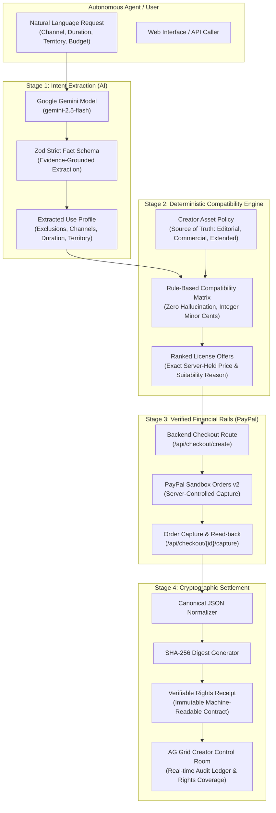

# OwnTerms Architecture & System Design

> *"Your agent can use it—after it licenses it."*

## System Guarantees

1. **Zero Financial Hallucination:** The AI model is strictly quarantined in Stage 1. It extracts structured facts only. It never receives pricing parameters or permission overrides.
2. **Server-Side Price Authority:** Every price is stored in integer minor cents (USD) on the creator's policy and verified on the server before dispatching to PayPal Orders v2.
3. **Cryptographic Nonce & Hash:** Each Rights Receipt produces a deterministic canonical SHA-256 digest binding order ID, capture ID, asset ID, tier, and granted scope.

